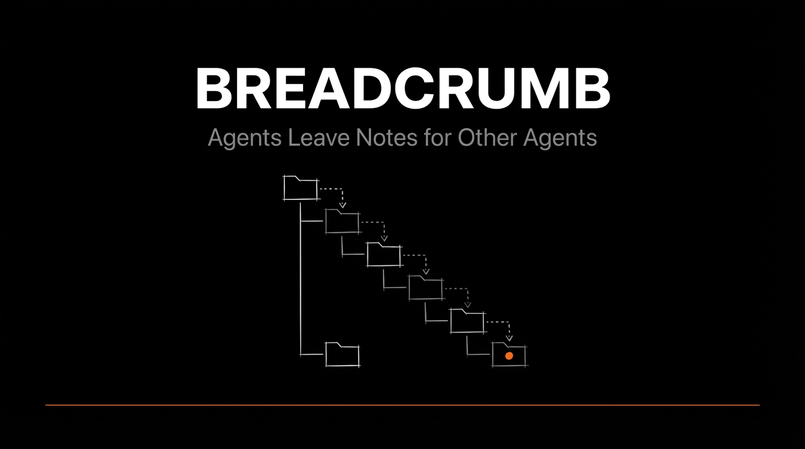
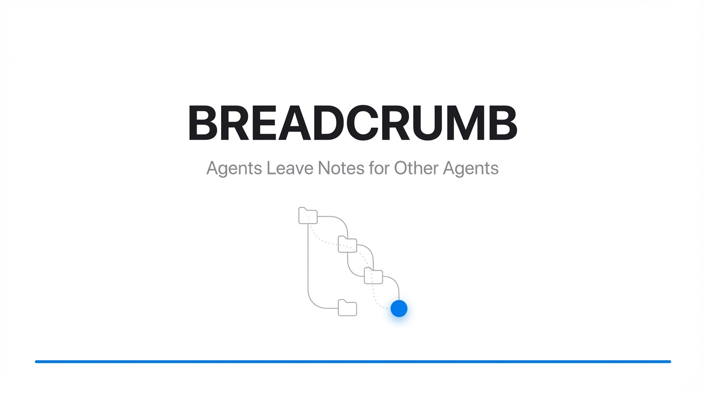

# slidegen

An agent-first CLI for generating PowerPoint presentations. Give it prompts, get slides. Built for AI agents (Claude Code, Cursor, Codex, etc.) that create decks as part of automated workflows.

<p align="center">
  
</p>

## Quick start

Requires [Bun](https://bun.sh).

```bash
git clone https://github.com/tylergibbs1/slidegen.git && cd slidegen
bun install && bun link          # puts `slidegen` on your PATH
export GEMINI_API_KEY=your_key_here

slidegen slide "Title slide: ACME Corp Q4 Results" -d ./slides
slidegen assemble ./slides -o deck.pptx
```

## How it works

1. **`slide`** sends a text prompt to Google Gemini or OpenAI's image generation model and saves the result as an image.
2. **`assemble`** takes a directory of images and packs them into a 16:9 full-bleed `.pptx`.

That's it. Generate slides in parallel, assemble when done:

```
slidegen slide "Title slide: ACME Corp Q4 Results" -d ./slides
slidegen slide "Revenue chart showing 40% YoY growth" -d ./slides
slidegen slide "Thank you / Q&A slide" -d ./slides
slidegen assemble ./slides -o deck.pptx
```

## Features

- **Structured output**: `-f json` on both commands for easy parsing by agents.
- **stdin support**: pipe prompts directly from agent workflows.
- **Auto-increment naming**: agents don't need to track slide numbers.
- **Predictable exit codes**: 0 success, 1 generation failure, 2 input error.
- **No interactivity**: no prompts, no confirmations, no TUI. Just input and output.
- **Parallel generation**: run multiple `slide` commands concurrently, assemble once.
- **Built-in styles**: `-s engineer`, `-s apple`, or `-s vercel` instead of hand-writing style prompts.
- **Two image providers**: Gemini (default) or OpenAI.

### Built-in styles

```bash
slidegen slide "Title slide: Q4 RESULTS" -s engineer
slidegen slide "Title slide: Q4 RESULTS" -s apple
slidegen slide "Title slide: Q4 RESULTS" -s vercel
```

<table>
  <tr>
    <td align="center"><strong>engineer</strong></td>
    <td align="center"><strong>apple</strong></td>
    <td align="center"><strong>vercel</strong></td>
  </tr>
  <tr>
    <td></td>
    <td></td>
    <td></td>
  </tr>
  <tr>
    <td>Dark engineering notebook, hand-sketched line art, orange accent</td>
    <td>Clean Apple keynote, SF Pro typography, blue accent</td>
    <td>Geist design system, Swiss grid, flat monochrome</td>
  </tr>
</table>

Styles are prepended to your prompt automatically. You can still pass raw prompts without `-s` for full control.

### Examples

A 10-slide BREADCRUMB deck generated entirely by an AI agent using slidegen, one per built-in style:

- [`breadcrumb-engineer.pptx`](examples/breadcrumb-engineer.pptx): dark engineering notebook
- [`breadcrumb-apple.pptx`](examples/breadcrumb-apple.pptx): clean Apple keynote
- [`breadcrumb-vercel.pptx`](examples/breadcrumb-vercel.pptx): dark Vercel developer aesthetic

## Installation

```bash
git clone https://github.com/tylergibbs1/slidegen.git
cd slidegen
bun install
bun link   # optional: exposes the `slidegen` command; otherwise run `bun src/index.ts`
```

Set the API key for the provider you want to use. Gemini is the default:

```bash
export GEMINI_API_KEY=your_key_here
```

For OpenAI image generation:

```bash
export OPENAI_API_KEY=your_key_here
```

## Usage

### Generate a slide

```bash
# From a prompt argument
slidegen slide "A clean dark infographic about cloud architecture"

# From stdin (agent-friendly)
echo "A minimalist title slide reading HELLO WORLD" | slidegen slide

# With options
slidegen slide "Your prompt" -d ./slides -n 01 -m gemini-3-pro-image-preview

# With OpenAI image generation
slidegen slide "A clean 16:9 product strategy slide" --provider openai
slidegen slide "A clean 16:9 product strategy slide" -m gpt-image-2
slidegen slide "A wide executive summary slide" --provider openai --size 1536x864
```

### Assemble into PowerPoint

```bash
slidegen assemble ./slides -o presentation.pptx
```

### JSON output for agents

```bash
$ slidegen slide "A dark slide" -f json
{"status":"done","image":"./slides/01.png","ms":8200}

$ slidegen assemble ./slides -f json
{"status":"done","output":"./deck.pptx","slides":5,"bytes":2516582}
```

## Image providers

| Provider | Default model | Required env var | Notes |
|----------|---------------|------------------|-------|
| Gemini | `gemini-3-pro-image-preview` | `GEMINI_API_KEY` | Default when no provider or OpenAI model is specified |
| OpenAI | `gpt-image-2` | `OPENAI_API_KEY` | Selected with `--provider openai` or any `gpt-image-*` / `dall-e-*` model |

OpenAI uses `1536x864` by default, a 16:9 size for slide generation. Override it with `--size`, for example `--size 1024x1024`.

## Command reference

### `slide`

```
slidegen slide <prompt> [options]

Options:
  -d, --dir <path>     Output directory (default: ./slides)
  -n, --name <name>    File name without extension (default: auto-increment)
  -s, --style <name>   Built-in style preset (engineer, apple, vercel)
  -p, --provider <p>   Image provider: gemini or openai (default: inferred from model)
  -m, --model <model>  Image model (default: gemini-3-pro-image-preview; OpenAI default: gpt-image-2)
      --size <size>    OpenAI image size (default: 1536x864 for gpt-image-2)
  -f, --format <fmt>   Output format: text or json (default: text)
  -h, --help           Show this help
```

`--provider openai` uses `gpt-image-2` by default. Passing `-m gpt-image-2` also selects the OpenAI provider automatically.

### `assemble`

```
slidegen assemble <images_dir> [options]

Options:
  -o, --output <path>  Output file path (default: ./deck.pptx)
  -f, --format <fmt>   Output format: text or json (default: text)
  -h, --help           Show this help
```

### Exit codes

| Code | Meaning |
|------|---------|
| 0 | Success |
| 1 | Generation or assembly failure |
| 2 | Input error (missing prompt, bad arguments) |

## Development

```bash
bun test   # tests live in tests/
```

## License

MIT
